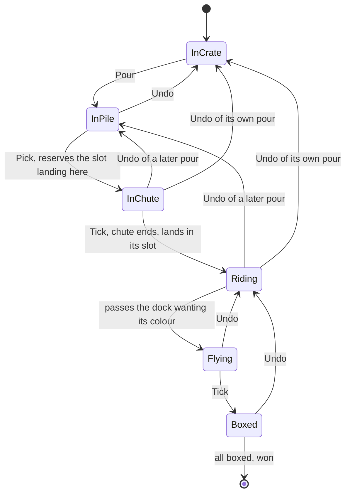

# Funnel Sort belt slots

**Property:** whatever order the player pours and undoes in, two marbles never hold the same belt slot, the rules and the belt agree on what is on the belt, and undo restores the whole state. If this broke, marbles would overlap on the belt or the rules would think a full belt had room.

**Tool:** TLC from `tla2tools.jar` v1.7.4, run in Docker by `bash scripts/check-models.sh` (about two minutes). The jar downloads to `.cache/` on first use. CI doesn't run it, so a download failure can't block a deploy: run it when `tap`, `undo`, `canEnter`, `pickFromNeck`, `slotFree` or `joinBelt` change.

## Guarantees

| Invariant | Meaning |
| --- | --- |
| `SlotsAreExclusive` | Two marbles on the belt or in the chute never hold the same slot |
| `LandingsNeverBounce` | A landing always finds its slot free; the model of the `bounces` counter soaks require to stay 0 |
| `LandingsAreInPlace` | A marble lands exactly where it reserved |
| `RulesAgreeWithSlots` | `rules.occupancy` equals the slots held and never exceeds capacity |
| `FreeRoomMeansFreeSlot` | Room in the rules always means a slot nobody holds |
| `BoxesNeverOverfill` | A box gets at most its size, one marble per pass |
| `UndoRestoresEverything` | Undo restores the complete saved state, in flight marbles included |
| `WaitingMarblesEnter` (liveness) | Marbles waiting with room on the belt get onto it, unless the player takes the pour back |

## How it maps to the code

| Model | `src/machine/machine.ts` |
| --- | --- |
| `Pour` | `tap`, with `rules.release` |
| `Undo` | `undo` restoring the `Saved` copy |
| `TickWith` | one aligned `step`: belt, `pickFromNeck`, then `updateExiting`/`joinBelt`, `updateRiding`/`rules.arrive`, `updateFlying` |
| `Reservable`, `NeckOpen` | `slotFree`, `canEnter` |
| `LandingSlot` | `landingOffset`, `nextSlot` |
| `pick` chosen freely | the pile: physics decides which marble reaches the neck and when |

## Assumptions and exclusions

- One `Tick` is the belt moving one slot, the only moment `nextSlot().aligned` lets the neck pick. Rounding of real offsets isn't modelled.
- `pick` is unconstrained, so the model allows any arrival order from the pile, a superset of what physics produces. Liveness assumes a resting marble is eventually offered (`SF_vars(Pick)`), which is what `shakeFeeder` and the recovery nudges exist to ensure.
- Crate opening, box motion and rendering aren't modelled. Undo copying world state correctly is an assumption here; `tests/machine/slot-invariants.test.ts` checks it on the real machine by comparing fingerprints.
- Bounds: one board of four marbles in two crates, one dock wanting blue then red, box size 2, capacities 2 to 4, chute delays 1 to 3. A pass says nothing beyond these. Real capacities are 14 and up, and real chute delays about 3 slots.

## Evidence

Checked against the working tree on top of commit `9e1a35c`. Update this when the transitions above change. The model runs whole-slot time, so the change to exact trigonometry made alongside it doesn't affect it.

| Config | Result |
| --- | --- |
| `pass-jam-c2-d1` | Holds, 17,252 distinct states |
| `pass-c2-d3` | Holds, 44,148 |
| `pass-c3-d1` | Holds, 168,054 |
| `pass-c3-d2` | Holds, 219,714 |
| `pass-c4-d3` | Holds, 1,958,280 |
| `live-c3-d2` | `WaitingMarblesEnter` holds, 219,714 |
| `mut-reservation-ignores-riders` | Must fail: `SlotsAreExclusive` violated |
| `mut-chute-holds-no-slot` | Must fail: `SlotsAreExclusive` violated |
| `mut-reserve-ignores-chute` | Must fail: `LandingsAreInPlace` violated |
| `mut-undo-keeps-belt` | Must fail: `UndoRestoresEverything` violated |
| `mut-undo-keeps-occupancy` | Must fail: `RulesAgreeWithSlots` violated |
| `reach-jam`, `reach-win`, `reach-undo-in-chute` | Must fail, proving jams, wins and undo with a marble in the chute are all explored |

The same breaks made in the real code (riders ignored by `slotFree`, belt kept across undo) fail `tests/machine/slot-invariants.test.ts`.

## What it found

No game bug. Two facts worth knowing:

- Marbles in the chute holding slots only matters when a chute holds a full lap of slots. `mut-chute-holds-no-slot` is caught only with capacity 2 and delay 3; on larger belts each pick reserves a different slot anyway. Real belts are far larger than the chute, so that check in `slotFree` is a safety margin.
- The `rules.free > 0` test in `canEnter` is redundant while slots are exclusive: a belt with no free slot already refuses the pick. It stays, because it ties the machine to the rules.

## States

The chart shows one marble. Each `Undo` arrow restores the copy saved before the pour being taken back, so where it lands depends on when that pour happened; the chart shows the common targets and hides the rest.

**Shortest failure, with `mut-reservation-ignores-riders`:**

1. Pour a crate.
2. Pick the first marble; it reserves a slot.
3. Tick until it lands and rides.
4. Keep ticking until the same slot lines up with the landing point again.
5. Pick the second marble: the check ignores riders, so it reserves the slot the first marble is in. `SlotsAreExclusive` breaks.
